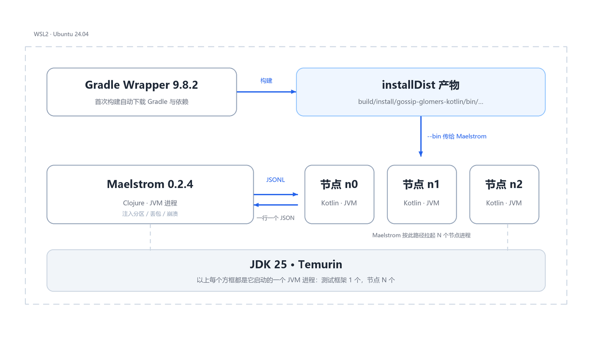

# 用一个 JDK 跑起分布式实验：环境与第一次测试

这是《用 Kotlin 做 Gossip Glomers 分布式实验》系列的第一篇。读完这一篇，你会有一条能复现实验的命令，和一个能看懂结果的目录——代码留到下一篇。

## 一、这组实验是什么

Gossip Glomers 是 Fly.io 出的一组分布式系统练习，一共六道题：Echo、唯一 ID、广播、GCounter、Kafka、事务。

它的设计有点反直觉：不需要集群、不需要 Docker、不需要云主机。Maelstrom 会启动 N 个子进程当作节点，每个节点只读标准输入、只写标准输出，一行一个 JSON。节点之间看起来在互相发消息——消息里有 `src`、有 `dest`——但实际上全部由 Maelstrom 中转，两个节点进程之间没有任何直接连接。

好处是：分区、丢包、进程崩溃、时钟漂移这些平时要搭一整套环境才能模拟的故障，它都能注入，而且整场测试的消息流水会落盘，事后可查。

它练的也不是"写一个数据库"，而是"在故障下先想清楚什么算对"：每道题都逼你先定义正确性，再去实现。

这六道题我会按顺序做一遍，重点放在"为什么这么设计"和"实测数据"上，不会把代码贴完了事。

每道题跑完，Maelstrom 会给出一组判定：操作数、失败数、可用性、消息数。所谓"通过"不是它说了算，而是这几个数字的组合——后面每一篇我都会把这些数字连参数一起贴出来，而不是只说一句"跑通了"。

> 说明：项目的基础代码由 Codex 生成，分布式逻辑也有 Codex 的辅助，博客由 DeepSeek 生成。文本中数据都来自本机真实运行，并附了运行参数，你可以自己复现。

## 二、为什么是 Kotlin

理由有三条，从重要到次要。

**第一，一套 JVM 栈同时覆盖测试框架和被测试代码。** Maelstrom 本身是 Clojure 写的，跑在 JVM 上；我写的节点也是 JVM 进程。所以"装 JDK"这一步不是为我的代码装的，是给两边共用的。Go 版要装 Go，Rust 版要装 Cargo，Python 版要配虚拟环境，都得额外引入第二个运行时；而这里从 `java -version` 到 `./lab test echo` 只用一个。

**第二，语言本身省事。** 协程让我用挂起代替回调和线程：等一个 RPC 就写一行调用，不用回调套回调；`kotlinx.serialization` 让 data class 直接映射 JSON，不用手写解析；再加上 data class、扩展函数、默认参数这些语法糖，业务代码能压得很短。后面你会看到 Echo 只有 16 行，其中一半还是 DTO。如果换成 Java，同样的东西得多写不少样板。

**第三，工具链成熟。** Gradle wrapper 自带版本，不用在系统里装 Gradle；依赖解析、测试、打包、生成启动脚本，都是现成的。

代价也说清楚：**25 节点的广播测试意味着 25 个 JVM 进程**，启动时间和内存都是实打实的成本。所以我没让每个节点跑 `gradle run`，而是先 `installDist` 打包，直接执行生成的启动脚本——这件事第四节还会出现。



图上是一条构建链：Gradle 构建出启动脚本，通过 `--bin` 交给 Maelstrom，由它拉起 N 个节点进程，两者之间走的就是 stdin/stdout；最下面那个框是重点——**所有进程共用同一个 JDK**。

## 三、环境

四样东西，装一个验一个。

### 3.1 WSL2 + Ubuntu

Maelstrom 是 Unix 二进制。Windows 上最省事的做法是 WSL2 + Ubuntu，我这里是 24.04。macOS 和原生 Linux 不需要这一层。

一个提前说明：代码要放在 WSL 自己的文件系统里（比如 `~/`），不要放 `/mnt/c`。后者走 9p 协议，构建又慢又可能出权限问题，第一次踩很浪费时间。

### 3.2 JDK 25

**必须是 25。** 项目的 `jvmToolchain(25)` 写死了版本，装 17 或 21 会在构建时报错，或者触发 Gradle 自动下载一个 JDK，时间不可控。

安装按 Eclipse Temurin 的官方教程来：[adoptium.net/zh-CN/installation/linux](https://adoptium.net/zh-CN/installation/linux)，Debian/Ubuntu 那一节给了 apt 源的完整步骤。装完验证：

```sh
java -version
# openjdk version "25.0.5" 2026-10-20 LTS
# OpenJDK Runtime Environment Temurin-25.0.5+8 (build 25.0.5+8-LTS)
```

版本号里的 25 是硬要求，vendor 无所谓——Temurin、Zulu、Oracle 都行。

### 3.3 Maelstrom 0.2.4

从 [github.com/jepsen-io/maelstrom](https://github.com/jepsen-io/maelstrom) 的 Releases 下载预编译包，解压后得到一个目录，里面有 `maelstrom` 可执行文件和 `lib/maelstrom.jar`。我把它放在 `~/tools/maelstrom-0.2.4/`。

验证：

```sh
~/tools/maelstrom-0.2.4/maelstrom --help
# Usage: lein run -- COMMAND [OPTIONS ...]
# Commands: analyze, demo, doc, serve, test
```

它会先打印四行 `WARNING`（`abs` 函数冲突之类），这是 Clojure 依赖在正常吵闹，不是错误，别被吓到。

项目的 `lab` 脚本按这个顺序找 Maelstrom：`MAELSTROM_BIN` → PATH 里的 `maelstrom` → `~/tools/maelstrom-0.2.4/maelstrom`。放在别处就设环境变量。

顺带一提，Maelstrom 除了拉起你的节点，还会起几个内置服务（`lin-kv`、`seq-kv`、`lin-tso` 之类）。现在用不上，等做到计数器和 Kafka 时，它们就是你的"外部数据库"。

### 3.4 项目与 Gradle

```sh
git clone https://github.com/origin-coding/gossip-glomers-kotlin.git
cd gossip-glomers-kotlin
./gradlew test
```

Wrapper 会在首次构建时下载 Gradle 9.8.2，依赖由 `build.gradle.kts` 和 `settings.gradle.kts` 里声明的仓库解析。下载量不小（含 Kotlin 编译器），第一次慢是正常的，别以为卡死了。

项目依赖只有两个：`kotlinx-serialization-json` 和 `kotlinx-coroutines-core`。没有 Web 框架、没有 DI 容器——Maelstrom 的通信只是一行行 JSON，框架在这里帮不上忙，后面讲运行时那篇会展开。

跑完测试应该看到 9 个测试类、29 个用例全绿：

```
> Task :test

BUILD SUCCESSFUL in 3s
```

#### 附录：从零建一个同样的工程

不想 clone 的话，关键就三块：

```kotlin
plugins {
    kotlin("jvm") version "2.4.21"
    kotlin("plugin.serialization") version "2.4.21"
    application
}

kotlin { jvmToolchain(25) }

dependencies {
    implementation("org.jetbrains.kotlinx:kotlinx-serialization-json:1.12.0")
    implementation("org.jetbrains.kotlinx:kotlinx-coroutines-core:1.11.0")
}
```

仓库里用的是版本目录（`gradle/libs.versions.toml`），坐标一样，只是版本集中在 toml 里；`application` 插件用来生成启动脚本，第四节会用到。

> **仅中文版**：国内可以把两处换成镜像加速——`gradle/wrapper/gradle-wrapper.properties` 的 `distributionUrl`，以及 `settings.gradle.kts` 里的 `maven(...)` 仓库地址。换源不用改 `distributionSha256Sum`，校验的是同一个 zip，哈希不变。另外 `settings.gradle.kts` 设了 `FAIL_ON_PROJECT_REPOS`，在模块里另声明仓库会直接失败，要改就改 settings。海外读者反过来做，换回官方源即可。

## 四、一条命令跑通

```sh
./lab test echo --log-stderr
```

`lab` 做了三件事：

1. `./gradlew installDist`：打出 `build/install/gossip-glomers-kotlin/`，里面是启动脚本和 jar；
2. 导出 `GOSSIP_GLOMERS_CHALLENGE=echo`，让同一个可执行文件知道该跑哪道题；
3. `exec maelstrom test -w echo --bin <启动脚本> --node-count 1 --time-limit 10`。

为什么不直接 `gradle run`？因为 Maelstrom 要为每个节点启动一个进程，`gradle run` 每次都过一次 Gradle 的启动和配置；测 25 个节点时这个开销很可观。`installDist` 生成的脚本本质是一条 `java -cp ...`，可以直接 exec。

至于那个环境变量：整个项目只打包出一个可执行文件，六道题都在里面，靠环境变量或命令行参数选。好处是评测时不用为每道题单独配置。

跑完，输出结尾是这次测试的判定，几个数字最值得看：

| 字段 | 这次的值 | 含义 |
| --- | --- | --- |
| `:ok-count` / `:fail-count` | 57 / 0 | 57 次操作全部成功 |
| `:availability :ok-fraction` | 1.0 | 没有失败窗口 |
| `:net :msgs-per-op` | **2.035** | 平均每次操作 2 条消息 |

参数是 1 节点、10 秒、rate 5（都是默认值）。

如果你加了 `--log-stderr`，日志里还会有一串 `:invoke` / `:ok` 行，每一对就是客户端的一次操作和结果：`:invoke :echo "Please echo 122"` 之后紧跟 `:ok :echo {:echo "Please echo 122", ...}`。想看单次请求的完整报文，翻 `history.txt` 更直接。

`2.035` 这个数字值得多看一眼。一次 echo 是"一条请求 + 一条响应"，两条消息；整场还有 `init` 和 `init_ok` 两条握手，摊到 57 次操作上：`(57×2 + 2) / 57 = 2.035`。也就是说，**运行时没有多发任何一条消息**——没有心跳、没有重发、没有多余的广播。

这个 2.0 是后面所有性能题的零点。广播 3d 是 4.6，Kafka 5b 是 8.7，到那时候你会看出差距。

### 看结果：`./lab serve`

每次测试的结果都落在**本机**的 `store/<时间戳>/` 下（`store/` 在 `.gitignore` 里，仓库里没有这个目录）：`history.txt` 是完整消息流水，`results.edn` 是判定，`timeline.html` 是可视化页面。

```sh
./lab serve
# 浏览器打开 http://127.0.0.1:8080
```

它起一个本地页面，按时间线把这次测试的操作、延迟和网络消息画出来。比翻文本快得多，而且能一眼看到"哪一秒发生了什么"——后面调广播和事务的时候，我基本都靠它定位问题。

不过文章里引用的数字得有地方可查。所以每次被引用的运行，都会把判定书单独归档一份到 `docs/runs/<实验>/<时间戳>/`，只有两个文件——`results.edn`（判定书）和 `params.txt`（命令行、git 提交、JDK 与 Maelstrom 版本），体积几 KB。这次 echo 的归档在 `docs/runs/echo/20261114T154500/`，你可以拿它对照上面表格里的每个数字。

归档由脚本完成：`./scripts/publish-run store/<实验>/<时间戳>`。你自己跑完想留证据，也可以这么用。

## 五、踩坑清单

1. **JDK 不是 25。** 构建报 toolchain 错误，或者 Gradle 开始默默下载一个 JDK。先 `java -version` 确认。
2. **找不到 maelstrom。** `lab` 会提示 `Install Maelstrom or set MAELSTROM_BIN...`。放进 `~/tools/maelstrom-0.2.4/`，或者设环境变量。
3. **第一次构建很久。** 在下 Kotlin 编译器和依赖，几百 MB，不是卡死。
4. **别在 `/mnt/c` 下构建。** 又慢又可能出权限问题，把代码放 WSL 原生文件系统。
5. **`--node-count` 传了两次。** `lab` 自己已经带了默认参数，你再传一次，argv 里就会出现两次（后一个生效）。结果没错，但看日志会怀疑自己。
6. **复制命令时注意破折号。** 官方文档里实验六试验命令的 `--nemesis` 使用的字符，可能是排版用的长横线（`–`）而不是两个 ASCII 短横线（`--`）。Maelstrom 不认识这个选项，会把它当作额外参数传给节点；节点程序用 `args.singleOrNull()` 取题目名，收到两个参数直接返回 `null`，打印一句 `Choose a challenge` 就退出了——看起来像"节点没启动"，其实是被一个字符坑的。正确写法是 `--nemesis partition`。这一点需要注意，我们在实验六里还会再提一次。

## 六、下一篇

你现在有的东西：一个能跑的平台、一条能复现的命令、一个能看结果的目录。剩下的全是业务代码。

下一篇：[Echo 与唯一 ID：第一批业务代码](https://github.com/origin-coding/gossip-glomers-kotlin/blob/main/blog/02-echo-uniqueid.md)——拆开 16 行实现，讲清"唯一"的三档保证强度。

---

**仓库**：[github.com/origin-coding/gossip-glomers-kotlin](https://github.com/origin-coding/gossip-glomers-kotlin)
