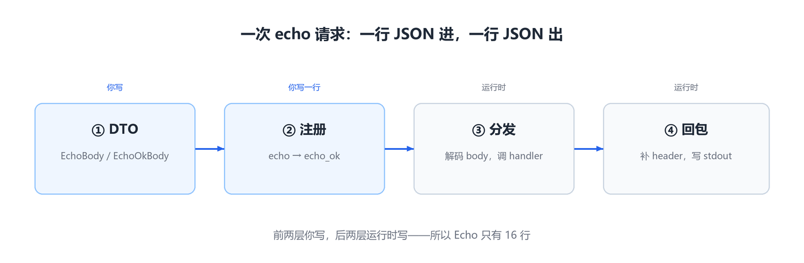

# Echo 与唯一 ID：第一批业务代码

上一篇你跑出了 57 次操作，但没看一行代码。这一篇做两件事：拆开 Echo 的 16 行，看一次请求走了哪四层；然后做第一道真正有分布式语义的题——唯一 ID。

Echo 只证明管道通了，唯一 ID 才开始问：**多个节点一起干活时，什么算对。**

## 一、从 57 次操作说起

上一篇那条命令跑完，Maelstrom 的结论是 57 次操作全部成功、`msgs-per-op 2.035`。这个数字是怎么来的，得先看懂一次交互里到底发了几条消息。

所以在讲代码之前，先把协议摆出来。这一节是后面所有实验的地基，值得慢慢看。

## 二、一条消息的解剖

Maelstrom 和节点之间只传三种东西：请求、回包、错误。它们长这样：

```json
{"src":"c1","dest":"n0","body":{"type":"init","msg_id":1,"node_id":"n0","node_ids":["n0","n1","n2"]}}
{"src":"c1","dest":"n0","body":{"type":"echo","msg_id":2,"echo":"Please echo 122"}}
{"src":"n0","dest":"c1","body":{"type":"echo_ok","msg_id":4,"in_reply_to":2,"echo":"Please echo 122"}}
```

**三层结构**：`src` 和 `dest` 在最外层，`body` 是任意 JSON，而协议头（`type`、`msg_id`、`in_reply_to`）全在 `body` 里面。第一次写的人几乎都会在这里栽一下——把 `msg_id` 当成和外层同级，结果取不到。

为什么 header 不放到外层？因为这样 `body` 对业务完全开放：你想加什么字段都行，不用担心和协议字段撞名。代价是每次取协议头都得先钻进 `body`，所以运行时做的第一件事，就是把这三个字段包装成 `Envelope` 上的扩展属性。

**每个字段谁填、什么时候填**：

| 字段 | 谁填 | 什么时候 |
| --- | --- | --- |
| `src` / `dest` | 运行时 | 每条消息 |
| `msg_id` | 发送方自增 | 每条消息 |
| `in_reply_to` | 应答方 | 只在回包里 |
| `type` | 业务代码或运行时 | 每条消息 |

注意上面第三条报文里有两个 ID：`msg_id` 是 n0 自己的流水号（4），`in_reply_to` 是它引用的请求号（2）。**一条回包里的两个 ID 通常不相等**，这是最常见的理解错误——很多人以为回包就是把 `msg_id` 抄一遍。

还有个细节：`msg_id` 只增不减、也不复用。这样即使一条响应迟到很久，运行时也能凭 `in_reply_to` 认出它是哪次请求的；超过等待窗口的直接丢掉，不会被误配给后来的请求。

还有一条容易忽略的规则：`init` 是**每个节点各收一次**，不是整个集群一次。三个节点就有三次握手、六条消息。这一点在第六节算消息账时很重要。

错误也是消息，`type` 为 `error`，带一个 `code`：

| 码 | 含义 |
| --- | --- |
| 10 | 不支持这个 `type` |
| 12 | 请求格式错（比如业务字段解不出来） |
| 20 | key 不存在 |
| 22 | CAS 条件不满足 |

后两个码到计数器和 Kafka 那几篇会反复出现。

## 三、Echo 的 16 行：四层

Echo 的完整实现，就这么点东西：

```kotlin
@Serializable
data class EchoBody(val echo: String)

@Serializable
data class EchoOkBody(val echo: String)

fun run() {
    Runtime().run {
        on<EchoBody, EchoOkBody>("echo") { request ->
            EchoOkBody(request.body.echo)
        }
    }
}
```

（省略了 package 和 import。`run()` 的大括号里那一行是全部业务逻辑：收到 `echo`，把 `echo` 字段原样返回。）

短是有原因的：四层里你只写了前两层，后两层都是运行时的事。



**第一层，DTO。** 两个 data class 只声明业务字段，`type`、`msg_id`、`in_reply_to` 一个都不写。响应 DTO 尤其不能写 `type`——`emit` 会统一填，而它前面有个守卫，业务代码自己塞 header 字段会直接抛异常。这条设计是有意的：**header 只有一个地方产生，就不会有两处不一致。**

**第二层，注册。** `on<I, O>(type)` 是运行时的扩展函数，签名大致是：

```kotlin
inline fun <reified I, reified O> on(
    type: String,
    responseType: String = "${type}_ok",
    noinline handler: suspend (Request<I>) -> O,
) {
    register(type, responseType) { message ->
        val decoded = json.decodeFromJsonElement<I>(message.body)
        json.encodeToJsonElement(handler(Request(message.src, message.msgId!!, decoded))).jsonObject
    }
}
```

（这里把异常处理省掉了，所以看起来不像最终代码。）注意默认响应类型是 `${type}_ok`：`echo` 自动对 `echo_ok`，`generate` 自动对 `generate_ok`。这个约定贯穿六个实验，只有极少数地方需要显式覆盖。

顺带解释一下 `reified`：`on<I, O>` 是 `inline` 函数，`I` 和 `O` 在编译期就是具体类型，所以运行时能直接 `decodeFromJsonElement<I>`，不需要你传一个 `KSerializer` 进去。这是 Kotlin 内联泛型带来的便利；换成 Java，就得显式传类型令牌。

**第三层，分发。** 运行时把 `body` 解码成 `I`，包成 `Request(src, msgId, body)` 交给 handler。这里有个细节值得知道：**解码失败会回 `error 12`，不是崩进程。** 实现上是把 `SerializationException` 转成 `RpcException(12)`，再由统一的错误路径回包。很多人第一次遇到"发个数字进去，节点回了个 error 12"会以为是崩溃，其实这是设计好的。

**第四层，回包。** handler 的返回值被序列化后，`emit` 补上 `type`、`msg_id`、`in_reply_to` 三条 header 再写出去。业务代码从头到尾不需要知道 `in_reply_to` 该填什么。

顺带说 `Request` 里为什么带 `src` 和 `msgId`：业务去重要用。Echo 不需要，但广播要记住"这条消息是谁转发的"，事务要记住"这个客户端是不是重发了同一笔"。现在知道有这个字段就行。

另外还有个 `EmptyBody`，用来表示"没有业务字段"。唯一 ID 的请求就是空的，第四节会看到。

**加一道新题只要两步**：在 `run()` 里注册 handler，然后在 `Main.kt` 的 `when` 里加一个分支。因为整个项目只打包出一个可执行文件，靠环境变量 `GOSSIP_GLOMERS_CHALLENGE` 或第一个命令行参数选题目——上一篇的 `lab` 脚本就是这么传的。

## 四、唯一 ID：一行代码

协议更简单：收到 `generate`，回 `generate_ok`，带一个 `id`。

有意思的是官方对 `id` 的要求。`unique_ids.clj` 的文档里原话是：

> IDs may be of any type--strings, booleans, integers, floats, compound JSON values, etc.

**类型任意**，检查器只验全局唯一。也就是说返回 `123`、`true`、甚至一个 JSON 对象都算过——很多人以为必须返回 UUID 字符串，这是误解。

我们的实现：

```kotlin
@file:OptIn(ExperimentalUuidApi::class)

@Serializable
data class GenerateOkBody(val id: String)

fun run() {
    Runtime().run {
        on<EmptyBody, GenerateOkBody>("generate") {
            GenerateOkBody(Uuid.generateV4().toHexDashString())
        }
    }
}
```

核心就一行 `Uuid.generateV4()`。选字符串形式的 UUID 是因为它好打印、好当 key，也不依赖任何协调——每个节点自己生成，不需要问别人。

两个细节：`kotlin.uuid.Uuid` 目前还是实验性 API，所以文件头要写 `@OptIn`；标准库里除了 `generateV4()` 还有 `generateV7()`（时间前缀版本），第五节会提到它。

## 五、三档"唯一"

这道题的代码只有一行，但"唯一"这个词值得展开——因为不同场景要的"唯一"根本不是一回事。

| 档 | 保证 | 典型实现 | 会怎么翻车 |
| --- | --- | --- | --- |
| 一 | 单进程内不重复 | 自增 `Long` | 进程重启后从头开始 |
| 二 | 集群内不重复 | `(nodeId, 计数器)`、随机 UUID v4 | 计数器忘了拼 nodeId，两个节点同时从 1 开始 |
| 三 | 全局有序、可比较 | 时间戳前缀（v7）、共识序号、TSO | 时钟回拨就乱序；跨节点时间不同步 |

两个反例，都是真实代码里会写出来的东西：

```kotlin
// 反例一：进程内计数器。n0/n1/n2 各自从 1 开始，必然撞车
class NodeLocalIds {
    private var n = 0L
    fun next(): String = "id-${++n}"        // 三个节点都会产出 "id-1"
}

// 反例二：拼了 nodeId，但重启后计数器归零
class PrefixedIds(private val nodeId: String) {
    private var n = 0L
    fun next(): String = "$nodeId-${++n}"   // 重启后又从 "$nodeId-1" 开始
}
```

反例一是"档一冒充档二"，反例二是"档二没考虑重启"。后者更隐蔽：测试里不重启就永远发现不了，一上线就出事。

档二还有第三种常见做法：**号段**。节点启动时向协调服务要一段（n0 拿 1–1000，n1 拿 1001–2000），之后自己发号，用完再去要。这样既不必每次发号都协调，也不会撞车。Snowflake 那类 ID 本质上是它的变体：机器位代替号段，时间位让 ID 大致有序——但只到"大致"，钟一退就乱。

UUID v4 的保证属于档二：128 位里 6 位是版本和变体，剩下 **122 位随机**，碰撞概率可以忽略，而且**完全无序**——这一点在下面两段会变得重要。

为什么 v4 够用：Maelstrom 只验档二，它只关心"有没有重复"。

为什么 v4 又不够用：这个系列后面有两处需要**可比**的号。Kafka 的 offset 必须单调递增，否则消费者没法断点续读；事务的版本号必须能全序比较，否则合并不了并发写。v4 那种纯随机的 ID 在这两个场景里一文不值。到时候要换成带时间前缀的 v7，或者干脆用共识服务发的序号。

所以这道题的正确答案不是"用 UUID"，而是**先想清楚你要哪一档**，再选实现。Maelstrom 只考第二档，但真实系统往往卡在第三档。

## 六、实测：两次运行的差距

跑了两次，参数和结果：

| 运行 | 参数 | 操作数 | 失败 | 重复 ID | `msgs-per-op` |
| --- | --- | --- | --- | --- | --- |
| 基线 | 3 节点 / 10 秒 / concurrency 3 / rate 5 | 55 | 0 | 0 | 2.109 |
| 高压 | 3 节点 / 10 秒 / concurrency 10 / rate 200 | **1952** | 0 | **0** | 2.003 |

为什么跑两次：第一轮太温和了，55 次操作、3 个并发客户端，随便一个实现都能过；第二轮 10 个客户端、约 2000 次操作，才有点说服力。两轮的 `duplicated-count` 都是 0。

`results.edn` 里还有一个容易忽略的字段：

```
:workload {:attempted-count 1952,
           :acknowledged-count 1952,
           :duplicated-count 0,
           :duplicated {},
           :range ["0027d49a-ba23-44be-9fe2-59749fe72f33"
                   "ffc0265d-8465-41a5-9f3c-63d27a9ba1fd"]}
```

`:range` 是这批 ID 的字典序最小值和最大值，说明检查器是**把全部 ID 收进去比较**，不是抽样——这比一句 `Everything looks good` 有说服力得多。

最后解释一个数字。上一篇 Echo 是 2.035，这里 2.109 和 2.003，看起来不一致，其实是同一个公式：

> 每节点一次 init 握手（2 条消息）+ 每次操作 2 条消息

- Echo（1 节点，57 次）：`(57×2 + 2) / 57 = 2.035`
- 唯一 ID 基线（3 节点，55 次）：`(55×2 + 6) / 55 = 2.109`
- 唯一 ID 高压（3 节点，1952 次）：`(1952×2 + 6) / 1952 = 2.003`

操作数越大，init 那几条消息被摊得越薄，`msgs-per-op` 就越接近 2。**2 是"一次请求 + 一次响应"的理论下限，不是巧合。** 反过来说，如果运行时开始偷偷重发，这个数字会立刻涨上去——所以我把它当体检项看：它贴着 2，说明没有多余动作；它涨了，先怀疑重试。后面广播会到 4.6、Kafka 到 8.7，那些多出来的才是真正要算的账。

## 七、坑与限制

**一、DTO 比协议窄。** Echo 的 `echo: String`、唯一 ID 的 `id: String`，而协议允许任意 JSON。官方 workload 只发字符串、只查唯一性，所以能过；但如果你给别人用，对端发个数字进来，Echo 会回 `error 12`——不会崩，但也不叫支持。这是有意的窄实现，知道边界在哪就行。

**二、这两个包是全部实验里仅有的两个零测试包。** `challenges/echo` 和 `challenges/uniqueid` 没有一个单元测试，正确性完全靠 Maelstrom 端到端验证。对 16 行代码来说够用，但别当成习惯——后面广播和事务的测试加起来有 9 个用例。

**三、实验性 API。** `kotlin.uuid.Uuid` 要 `@OptIn(ExperimentalUuidApi::class)`，未来签名可能变。想稳妥就用 `java.util.UUID.randomUUID()`，效果一样，只是没有 `toHexDashString()` 这类便利方法。

**四、这两个实验都没有故障注入。** 跑的是干净网络，没有分区、没有丢包、没有节点崩溃。所以它们验证的是"协议用对了"，不是"容错做对了"。广播和事务那几篇会开始注入故障，那时候的数字才真正难看得起来。

## 八、下一篇

上一篇：[一个 JDK 跑起六个分布式挑战](https://github.com/origin-coding/gossip-glomers-kotlin/blob/main/blog/01-intro-setup.md)

到这里你已经会写业务题了：写 DTO、注册 handler、让它回包。四层里后两层是运行时做的，你只写了前两层。

但有两个问题还悬着：**handler 是可以挂起的，它等别人回话的时候谁在干活？两个 handler 同时在跑的时候，状态谁来护？**

下一篇拆运行时。

---

**仓库**：[github.com/origin-coding/gossip-glomers-kotlin](https://github.com/origin-coding/gossip-glomers-kotlin)
**本篇数据**：`docs/runs/unique-ids/20261114T162228/`（基线）、`docs/runs/unique-ids/20261115T212202/`（高压）
