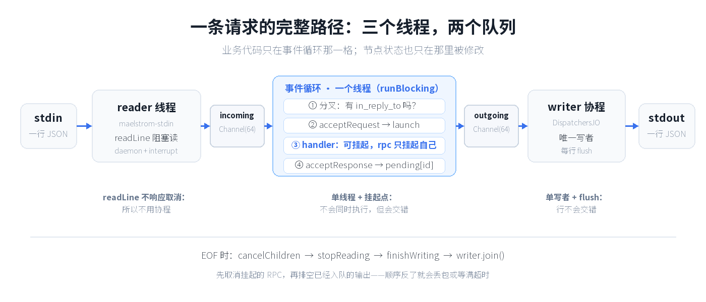

# 拆开运行时：一个线程、两个 Channel、三处不保证

Maelstrom 节点就是一个读 stdin、写 stdout 的进程。

一条请求进来，一行 JSON 出去：这篇拆开它内部。请求经过哪些线程、handler 为什么能挂起、状态为什么不用加锁。

上一篇你只写了 Echo 和唯一 ID 的 handler：两个 DTO、一行 `on(...)`、一个返回值。四层里你写的是前两层——DTO 和注册；后两层，解码分发和填头回包，一直是运行时替你做的。这篇把后两层拆开，回答上一篇结尾留下的两个问题：handler 挂起时谁在干活？两个 handler 同时跑，状态谁来护？

答案可以压成一句话：三个决定，各自放弃一种保证——**不保证并行安全，不保证字节流有消息边界，不保证超时等于失败**。运行时只保证一件事：把协议消息原样搬进搬出。

## 一、一条请求的完整路径

`Runtime.run()` 是阻塞调用，但它做的第一件事不是进循环，而是等 `init`：

```kotlin
val first = transport.receive() ?: return@coroutineScope
require(first.type == "init" && first.inReplyTo == null) { "First message must be init" }
val init = json.decodeFromJsonElement<InitBody>(first.body)
require(first.dest == init.nodeId)
val node = Node(init.nodeId, init.nodeIds, json, this, transport::send)
try {
    node.configure()
    node.finishRegistration()
    node.reply(first, "init_ok", JsonObject(emptyMap()))
    while (true) {
        val message = transport.receive() ?: break
        require(message.dest == node.id) { "Message addressed to ${message.dest}" }
        if (message.inReplyTo != null) {
            node.acceptResponse(message)
        } else {
            require(message.type != "init") { "Node has already been initialized" }
            node.acceptRequest(message)
        }
        yield()
    }
}
```

注意 `init` 不经过 handler 表：它由 `Runtime` 自己处理，`configure()` 里注册 `init` 会被 `require` 挡下来。握手只发生一次，不该和业务请求共用一条路径。

从 stdin 到 stdout，一条请求走五步：

1. 守护线程 `readLine` 读到一行 JSON；
2. 投进 `incoming` 队列，主线程从队列取出来；
3. 主循环按 `in_reply_to` 分叉：有就是在等回包的响应，没有就是新请求；
4. 新请求交给 `acceptRequest`，它 `launch` 一个协程跑 handler；
5. handler 的返回值由 `emit` 补上 header，投进 `outgoing` 队列，writer 线程写回 stdout。



这条路径跨了三个线程、两个队列，而你的业务代码只占中间那一格。运行时不解析业务字段、不做路由决策、不管拓扑——它只做协议。

开销也是可以算的：Echo 一次交互 2 条消息，`msgs-per-op` 就是 2.035；而 g-counter 一次 `add` 要读一次再 CAS 一次，两条 RPC，3 节点 10 秒的实测 `msgs-per-op` 直接到 5.0。多出来的消息都来自业务代码自己的 RPC 调用，运行时只是照单转发。

## 二、决定一：单线程事件循环，不是线程池

`runBlocking` 给了一个单线程事件循环，`coroutineScope` 让节点任务成为它的孩子。`Node` 拿到的 `scope` 就是这个作用域，所以 `background` 启的任务、`every` 启的周期任务、每个请求的 handler，全在这一条线程上排队执行。

分发只有十几行，但每一行都有用：

```kotlin
// Node.kt: 每条请求一个协程，路由本身不等待 handler 完成
scope.launch {
    val response = try {
        handler.handle(message)
    } catch (e: RpcException) {
        replyError(message, e.code, e.message ?: "RPC error")
        return@launch
    } catch (e: RpcTimeoutException) {
        replyError(message, ErrorCode.TIMEOUT, e.message ?: "RPC timed out")
        return@launch
    }
    reply(message, handler.responseType, response)
}
```

这回答了第一个问题：**handler 挂起时，干活的是同一个线程**。不是线程池换了个人，是协程在挂起点换了个协程。慢 handler 卡在 `await()` 上的时候，主循环照样收下一条消息、照样启动新的 handler。

错误处理的长相也由这个决定：`RpcException` 和 `RpcTimeoutException` 被就地转成错误回包，因为它们属于"业务可预期的失败"；其他异常一个都不接，直接向上抛，让整个 `coroutineScope` 失败。换句话说，编程错误**不该**伪装成一次 RPC 失败——节点自己坏了就该停下，而不是对着一肚子坏状态继续回包。

`NodeTest` 里有一条测试专门钉"挂起不挡路"：

```kotlin
h.node.on<EmptyBody, EmptyBody>("slow") {
    h.node.rpc("seq-kv", "read")   // 挂在这里
    EmptyBody
}
h.node.on<EmptyBody, EmptyBody>("fast") { EmptyBody }
h.node.acceptRequest(incoming("slow", 10))
h.node.acceptRequest(incoming("fast", 11))
assertEquals(11L, h.next().inReplyTo)   // fast 先回
```

`fast` 的 `in_reply_to` 是 11，先出现；`slow` 的 10 要等 KV 回话才出现。如果这里换成"一条消息一个线程"，顺序就不确定了。

还有一个容易漏掉的细节：主循环末尾那个 `yield()`。入向队列持续有货时，`receive()` 从不挂起，主循环会一路空转，把刚 `launch` 出去、还没跑过的协程饿死。每条消息处理完让出一次，已经排队的 handler 才有机会执行。

### 状态谁护

这是第二个问题的落点。

`Node` 里的 `handlers` 和 `pending` 都是普通 `mutableMapOf`，没有一处 `synchronized`。安全的前提只有一条：同一时刻只有一个协程在执行。所以"不用锁"不是随手写出来的，是单线程换来的——这是第一个决定的收益。

但这句话最容易被读成"单线程所以状态随便改"。**真正的边界不是线程，是挂起点。** 过了 `delay`、`await`、`yield` 之后，另一个 handler 的整段代码可能已经插进来了。两个 `add` 都读到 0、各加 1、各写回 1，最后是 1 而不是 2。这不是理论推演，`NodeTest` 里有一条测试就演示它，断言结果是 1：

```kotlin
var total = 0L
node.on<DeltaBody, EmptyBody>("add") { request ->
    val current = total
    delay(10)                            // 挂起点：另一个 add 可以在这之间跑完整段
    total = current + request.body.delta
    EmptyBody
}
node.acceptRequest(incoming("add", 1, buildJsonObject { put("delta", 1) }))
node.acceptRequest(incoming("add", 2, buildJsonObject { put("delta", 1) }))
delay(50)
assertEquals(1L, total)                  // 两次 +1，最后是 1
```

单线程给的是"不会同时执行"，不是"不会交错"。跨挂起点的读-改-写要么串起来（`Mutex`、专属队列），要么改成单次原子操作。

再往上一层还有一句更难听的话：**本地 `Mutex` 护得住同进程，护不住跨节点。** 两个节点各自加锁、各自自增，加起来照样不对。跨节点的互斥只有一种实现方式——CAS 或共识。这句话在第 6 篇会变成具体的代码。

### 这个决定的代价

约定没有代码强制。在 handler 里写 `withContext(Dispatchers.IO) { ... }` 修改节点状态，就同时有两个线程碰同一批 map，而编译器不管、类型系统不管；能拦住你的只有 `Node.kt` 第 22 行那行注释和 `docs/runtime.md` 里的一句提醒。`Thread.sleep` 和嵌套 `runBlocking` 同理：一个卡住整条线程，一个把事件循环锁死。

运行时能做的只是"别给你提供线程池"，不能"阻止你自己去拿一个"。

## 三、决定二：一个 reader、一个 writer、两个 Channel

stdio 是字节流，而协议是行。字节流没有消息边界，所以运行时自己划一条：**一行一条 JSON，一行写完再写下一行**。如果两个线程各自 `println`，两个 JSON 的字节就会交错，对端 `readLine` 读到的是一行废字符串。

```kotlin
private val incoming = Channel<String>(64)
private val outgoing = Channel<Envelope>(64)

// reader：守护线程。readLine 阻塞且不保证响应取消，所以不用协程
reader = thread(name = "maelstrom-stdin", isDaemon = true) {
    val buffer = input.bufferedReader(Charsets.UTF_8)
    while (true) {
        val line = buffer.readLine() ?: break
        incoming.trySendBlocking(line).getOrThrow()
    }
    incoming.close()
}

// writer：唯一的 stdout 写者，每行 flush
val writer = scope.launch(Dispatchers.IO) {
    val buffer = output.bufferedWriter(Charsets.UTF_8)
    for (message in outgoing) {
        buffer.write(json.encodeToString(message))
        buffer.newLine()
        buffer.flush()
    }
}
```

**reader 只能是线程。** `readLine` 是阻塞调用，而且不保证响应 interrupt——一个卡在 `readLine` 上的协程取消失不掉，所以只能开线程，取消时用 `interrupt` 兜底，进程退出时靠 daemon 身份直接收走。这是"协程不适合包装所有阻塞操作"的典型例子：协程的取消是协作式的，`java.io` 不跟你协作。

**writer 只能是单数。** 只有一个写者，行才不会交错；每行 flush，才不会攒着不发。这两条加起来，才使"一行 = 一条消息"这个假设在接收端成立。

两个 64 也不是同一个作用：

- **入向满**：`trySendBlocking` 阻塞 reader 线程，读不动了，反压顺着管道传回 Maelstrom；
- **出向满**：`send` 挂起，连 handler 的回包都要排队，`rpc` 的超时把排队时间也算在内。

所以 64 的作用是**让背压传得回来**，不是把消息扔掉：满了就停，位置空出来才收下一条。

这个决定放弃的保证是"处理能力"：输入队列有界，在跑的 handler 没有上限。每个请求一个 `launch`，请求来得比处理快，协程就堆着。它不漏消息，也不限流——它放弃的正是“处理得过来”这个保证。

## 四、决定三：RPC 只试一次，超时是"不确定"

`rpc()` 的顺序值得单独看：**先登记，再发送**。

```kotlin
val requestId = nextMessageId++
val waiter = CompletableDeferred<Envelope>()
pending[requestId] = PendingRpc(destination, expectedType, waiter)
try {
    val response = withTimeoutOrNull(timeout) {
        emit(destination, type, body, messageId = requestId)
        waiter.await()
    } ?: throw RpcTimeoutException(destination, type)
    // ...
    return response.body
} finally {
    pending.remove(requestId)
    waiter.cancel()
}
```

如果反过来先发后登记，回包可能在登记之前就到了——`emit` 里的 `send` 是个挂起点，同一线程上的另一条协程完全可能先跑完并处理了响应，于是这条响应被当成"未知的 `in_reply_to`"丢掉，调用方只能干等超时。这个 bug 只在并发下出现，没有对应的测试就很难发现。

`withTimeoutOrNull` 包住了 `emit` 和 `await` 两段，所以超时时间**包含等输出队列的时间**。如果不含，一个堵住的 writer 就能让 RPC 的实际耗时无限拉长，而调用方还以为自己设了上限。

回包匹配要过三道检查：

| 检查 | 不满足时 |
| --- | --- |
| `in_reply_to` 在 `pending` 里 | 迟到、重复、已取消 → 静默忽略 |
| `src` 等于请求的目标节点 | 忽略，防止串到别的节点 |
| `type` 等于预期类型，或 `error` | 完成一个可见的协议异常 |

三条都在 `acceptResponse` 里：查表、核对来源、最后比对类型。失败也分两种：

- `RpcException`：远端明确拒绝了，带错误码（22 = CAS 条件不满足）；
- `RpcTimeoutException`：**没收到确认，不等于没执行。** 回给客户端时用 `code 0`，协议里"不确定"的那个码。

默认超时 1 秒。Maelstrom 的节点之间是本地进程管道，往返在毫秒级，1 秒的余量足够覆盖 GC 抖动和一轮背压排队；换成跨机部署，这个数就得跟着网络延迟重算。

### 不重试的代价

一次尝试、不自动重试，是运行时最"不体贴"的地方，也是第 6 篇的伏笔。同参数跑了四次（3 节点 / 10 秒 / g-counter）：

| 运行 | 操作数 | add | add 冲突 | `ok-fraction` | 最终读 |
| --- | --- | --- | --- | --- | --- |
| 第 1 次 | 48 | 21 | 7 | 0.854 | 32 / 32 / 32 |
| 第 2 次 | 52 | 15 | 4 | 0.923 | 22 / 22 / 20 |
| 第 3 次 | 54 | 22 | 6 | 0.889 | 22 / 22 / 22 |
| 第 4 次 | 51 | 22 | 4 | 0.922 | 36 / 29 / 36 |

add 冲突率在 18%–33% 之间，`ok-fraction` 落在 0.85–0.92。**这不是测量误差，是竞态**：四次运行里操作数、add 数、撞上的次数每次都在变。报文原文是 `current value 5 is not 4`——两个节点都从 4 出发，一个先把 4 改成 5，另一个拿着旧的 4 去 CAS，就被拒了。

表里第 2、4 次的最终读不在可接受区间（`22 22 20`、`36 29 36`），那是另一处不保证：`seq-kv` 的读允许落在 32 个历史状态中的任意一个，第 6 篇拆它。这里只需要记住一句：被拒绝的那次 add 没有重试，在 Maelstrom 眼里就成了"不确定"，可用性跟着掉。

为什么不做自动重试？因为重试需要去重键和幂等保证，而运行时不知道业务是否幂等：广播的集合合并可以重发，`add` 不能重发（重发就是多加一次）。**运行时如果偷偷重试，就等于把"不确定"包装成"确定"，那才是真正的撒谎。** 把决定权交还给业务，是这个设计里唯一诚实的选项。

## 五、收尾：EOF 先取消，再排空

stdin 关掉之后，运行时做四件事，顺序不能换：

```kotlin
} finally {
    // EOF 后不会再收到响应，取消等待者和后台任务。
    coroutineContext.cancelChildren()
}
// ...
transport.stopReading()
transport.finishWriting()
// 正常 EOF 时排空已入队的输出；不等待未完成的网络操作。
withContext(NonCancellable) { writer.join() }
```

1. **取消子协程**：挂着的 `rpc` 立刻结束，不用等满 1 秒；
2. **关入向队列**：唤醒卡在 `readLine` 上的 reader；
3. **关出向队列**：writer 的 `for` 循环自然结束；
4. **`join`**：只等已经入队的输出写完。

这里有个容易被忽略的层级关系：writer 是 `Runtime.run()` 里、`coroutineScope` **之外**启动的，它是 `runBlocking` 的孩子，不是那个 `coroutineScope` 的孩子。所以第 1 步的 `cancelChildren()` 取消的是 handler、RPC 和后台任务，碰不到 writer——正是靠这个层级关系，排空才成立。要是 writer 也挂在同一个作用域下，取消就会连"写最后一行"的机会一起拿走。

顺序反过来的代价很具体：先关 writer 会丢掉已排队的回包；先 `join` 会等满每一条挂起 RPC 的超时。

`RuntimeTest` 里有一条测试把这件事钉死：handler 里发一个 `timeout = 60.seconds` 的 RPC，然后立刻关掉 stdin。如果收尾不先取消，测试会挂 60 秒；实际它是毫秒级退出。

`NonCancellable` 也是必需的：退出过程本身处在取消传播里，不隔离出来的话，`join` 自己会先被取消。

## 六、三处不保证，一条边界

把三处不保证凑到一起，就是运行时的边界。

**协议层不保证不崩。** `receive()` 解 `Envelope` 失败、主循环的 `require(dest == node.id)`、`acceptRequest` 的 `requireNotNull(message.msgId)`——这些异常都没有被捕获，进程直接退出，stderr 上一行堆栈。对比一下：业务字段解不出来会回 `error 12`，协议头坏了却不回。同一个"坏消息"，差一层就是两种待遇。没有 `msg_id` 的请求会杀节点，就是这条的具体形态：Maelstrom 自己不会发，实验里永远踩不到，但"保证不崩"和"只保证协议"是两种完全不同的承诺，这里选的是后者。

**调度层不保证公平。** 单线程是约定不是事实，没有任何机制阻止你在 handler 里换调度器，多开几条线程照样能跑，只是状态不再安全；输入队列有界，在跑的 handler 却没有上限。调度器不承诺公平，也不承诺隔离。

**拓扑层不保证知道集群形状。** `every(interval)` 只保证"先等一个间隔、跑完再等下一个、不重叠"，它不知道哪台节点该发起 gossip、什么时候算"拓扑就绪"。第 4 篇的广播要自己等 ready 信号。

运行时只保证协议：消息搬进搬出，header 填对，错误码合理。幂等、限流、拓扑发现，一律在业务层。

## 七、下一篇

三个决定，三种放弃：并行安全换成无锁的状态访问，消息边界换成单写者的行，失败语义换成不撒谎的"不确定"。

下一篇开始广播（3a–3c）。那道题会一次踩上三个：要在 handler 里 fanout 多条 RPC，要等传播完成，还要在挂起点之间护住消息集合。

---

**仓库**：[github.com/origin-coding/gossip-glomers-kotlin](https://github.com/origin-coding/gossip-glomers-kotlin)
**代码**：[Runtime.kt](https://github.com/origin-coding/gossip-glomers-kotlin/blob/7d39ebd/src/main/kotlin/io/github/origincoding/gossipglomers/runtime/Runtime.kt) · [Node.kt](https://github.com/origin-coding/gossip-glomers-kotlin/blob/7d39ebd/src/main/kotlin/io/github/origincoding/gossipglomers/runtime/Node.kt) · [StdioTransport.kt](https://github.com/origin-coding/gossip-glomers-kotlin/blob/7d39ebd/src/main/kotlin/io/github/origincoding/gossipglomers/runtime/StdioTransport.kt)
**本篇数据**（3 节点 / 10 秒 / `--log-stderr`，提交 `7d39ebd`）：

- `docs/runs/g-counter/20261121T125027-valid-1/`：48 次操作，`ok-fraction` 0.854
- `docs/runs/g-counter/20261121T203312-valid-2/`：54 次操作，`ok-fraction` 0.889
- `docs/runs/g-counter/20261121T125110-stale-1/`：52 次操作，最终读 22/22/20，20 低于可接受下限 22
- `docs/runs/g-counter/20261121T203339-stale-2/`：51 次操作，最终读 36/29/36，其中 29 不在可接受区间

**渲染提醒**：文中的 `return@coroutineScope`、`return@launch` 是 Kotlin 的返回标签，不是注解。部分 Markdown 预览（例如 VS Code）会把 `@` 之后的内容当作注解另起一行，以平台渲染为准。
